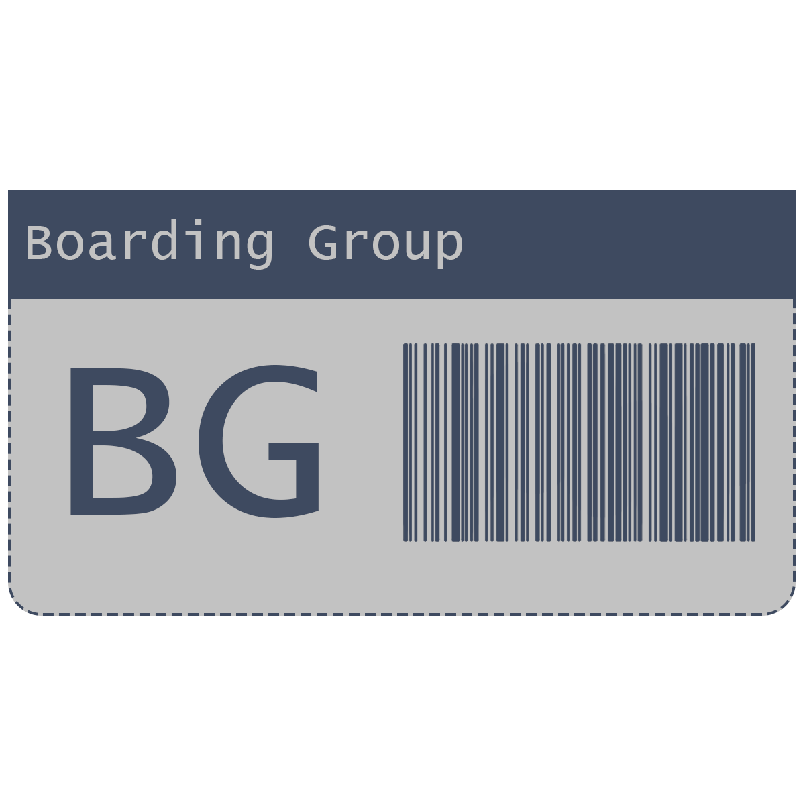

# Boarding Group  

### What?

Boarding group is a travel planner for colabration between you and your group (friends). Organize your trip, share your plans, schedule events, and suggest ideas.

### Where?

Runs in your [browser!](https://fencinglefty.com/BoardingGroup)

### Who?

Made for groups, or just one person.

## How?

### Start
Open the website, and create an account.

On your account page, create a new trip, and invite people (optional).

You can change trip details, and share with people to collabarate in the trip editor.

### Continue

To pick back up, load the trip on your account page.

## Screenshots

## How it was made

Made with Supabase, FullCalendar, Resend, Github pages, javascript, html.

## Ai use

Some as was used for debuging. Ai was also used for some parts of backend code.

#

© FencingLefty. MIT licence.